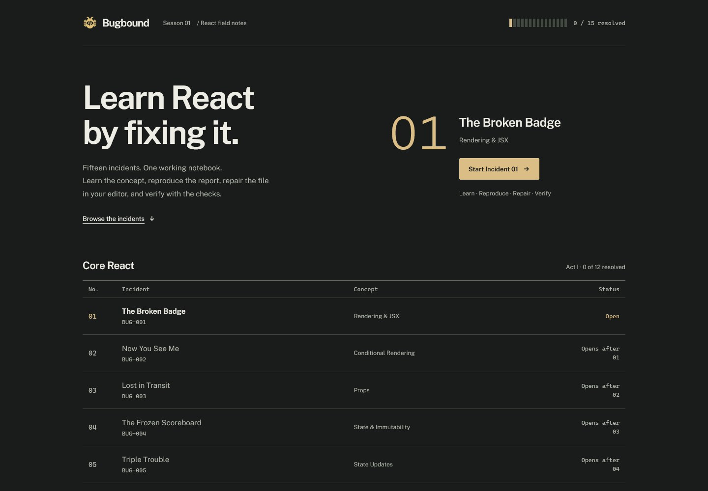

# Bugbound — Season 01

> **Learn React by fixing it.** An on-call field notebook of 15 intentionally broken React components — and you're the engineer on call.

Bugbound is a local, editor-first React debugging game. Instead of watching tutorials or typing into a sandboxed web textarea, you work through **15 escalating incidents** (`BUG-001` to `BUG-015`) in your own code editor beside a desktop browser. Each incident teaches one React concept, hands you a QA-style bug report and a live misbehaving component, and verifies your fix in the browser as Vite hot-reloads your edits.



> **Desktop-first by design.** Solving incidents requires a local code editor, Vite HMR, and a desktop browser running side by side. Phones and touch devices display a setup notice while still allowing you to browse the incident register and lessons.

---

## How it works

Every incident follows the same four-step loop — **Learn · Reproduce · Repair · Verify**:

| Surface | Role in the loop |
|---|---|
| **Incident register** | A ruled ledger split into **Act I — Core React** (`01`–`12`) and **Act II — The TypeScript Arc** (`13`–`15`). Returning visits lead with your current open incident and activity record; resolving all 15 displays your complete season record (`15/15`). |
| **Bug report (`BUG-###`)** | Describes the observable symptom and points to where to look — with **Copy path** and dev-mode **Open in editor** actions. Early incidents name the exact file; later ones point to a folder to investigate. |
| **Concept** | A concise, three-paragraph field note on the underlying React mechanism (state snapshots, reconciliation keys, effect cleanup, stale closures, discriminated unions, …). |
| **Workbench & Live preview** | A sticky verification bar (`Run checks` or <kbd>Ctrl+Enter</kbd> / <kbd>⌘ Enter</kbd>) above an isolated preview iframe running the broken component. Crash boundaries recover automatically on save, and **Restart preview** resets component state and timers. |
| **Verification log** | Runs each check in a fresh disposable iframe (`src/shell/harness.jsx`), driving real DOM events and folding repeated crash causes. Resolving an incident records the timestamp and run count in the log alongside a **"Make the fix stick"** reflection prompt. |
| **Field notes & Hints** | Check attempts, resolving run numbers, and hint usage are stored locally as your personal field notes. Each incident has three base64-encoded hints (`Gentle nudge`, `Closer look`, and `Basically the answer`, which asks for confirmation before revealing). |

### Progress & persistence

- **Saved vs. verified:** Completion is saved to `localStorage` and synchronized across tabs using additive generation keys (`src/shell/progress.js`). A recorded resolution is history — re-running checks later tests the current source on disk without erasing your saved completion.
- **Field notes (`bugbound:learning:v1`):** Tracks check runs, pass/fail counts, hint tiers opened, and timestamps per incident (`src/shell/learning.js`). Resetting progress relocks Incidents `02`–`15` while keeping your field notes intact.
- **Spoiler-free repository ("Blind mode"):** All hints in `src/levels/hints.json` and reference fixes in [`SOLUTIONS.md`](SOLUTIONS.md) are base64-encoded so searching the repo never spoils a bug.

---

## Curriculum (15 Incidents)

**Why JavaScript first?** React does not ship with TypeScript by default, and Season 01 is built to teach core React fundamentals first. Starting in plain JavaScript (`.jsx`) keeps the focus strictly on React's runtime mental model — rendering, state snapshots, reconciliation, and effect lifecycles — without type annotations or compiler errors getting in the way. Once those basics are solid across the first 12 incidents, **Act II** introduces React with TypeScript (`.ts`/`.tsx`) to show how static types reinforce component contracts, custom hooks, and reducers.

### Act I — Core React (JavaScript)

| No. | ID | Incident | Concept | Severity |
|---|---|---|---|---|
| `01` | `BUG-001` | **The Broken Badge** | Rendering & JSX | Low |
| `02` | `BUG-002` | **Now You See Me** | Conditional Rendering | Low |
| `03` | `BUG-003` | **Lost in Transit** | Props | Low |
| `04` | `BUG-004` | **The Frozen Scoreboard** | State & Immutability | Medium |
| `05` | `BUG-005` | **Triple Trouble** | State Updates | Medium |
| `06` | `BUG-006` | **Musical Chairs** | Lists & Keys | Medium |
| `07` | `BUG-007` | **The Unresponsive Form** | Controlled Forms | Medium |
| `08` | `BUG-008` | **Stuck in the Past** | Effect Dependencies | High |
| `09` | `BUG-009` | **The Haunted Stopwatch** | Effect Cleanup | High |
| `10` | `BUG-010` | **Photo Finish** | Async & Race Conditions | High |
| `11` | `BUG-011` | **Out of the Loop** | Context | High |
| `12` | `BUG-012` | **The Render Storm** | Memoization & Renders | High |

### Act II — The TypeScript Arc

| No. | ID | Incident | Concept | Severity |
|---|---|---|---|---|
| `13` | `BUG-013` | **Any Port in a Storm** | TypeScript: Typing Data | High |
| `14` | `BUG-014` | **Hook, Line & Sinker** | TypeScript: Typing Hooks | Critical |
| `15` | `BUG-015` | **The Final Boss** | Capstone: Reducers + TS | Critical |

Difficulty ramps two ways: the concepts get deeper, and the bugs get better at hiding (single file → multi-file component trees → folder-only targets with interacting bugs).

---

## Getting started

```bash
npm install
npm run dev
```

Open `http://localhost:5173`, start **Incident 01**, and keep your editor open beside the browser.

**Open in editor** beside each file path asks Vite's dev server (`/__open-in-editor`) to open the file in your running editor (VS Code, Cursor, WebStorm, etc.), or uses the command set in `LAUNCH_EDITOR` (for example `LAUNCH_EDITOR=code`). If nothing opens, use **Copy path**.

## House rules

- **Keep your exercise edits in `src/levels/`.** `src/shell/` is application infrastructure. Every planted bug lives inside `src/levels/`.
- **Keep `data-testid` attributes and `manifest.js` checks intact** — they are the executable specification. Reading a level's `manifest.js` when stuck is fair game, just like reading a failing test suite at work.
- **Keep `main` pristine — it's the game cartridge.** Play on your own branch and commit your fixes there:

  ```bash
  git checkout -b playthrough
  ```

  Your commits become a log of what you repaired. To reset a single incident back to its broken starting state, run `git restore --source=main src/levels/01-broken-badge/`. Browser completion is separate: use **Reset progress** in the footer to relock completed incidents.
- **Using an AI coding assistant?** Ask it to **coach, not solve** — the in-app hints are paced so you can still make the discovery yourself.

---

## Architecture & tech notes

- **React 19 + Vite + plain CSS (zero UI dependencies).** The shell follows the on-call field notebook system documented in [`DESIGN.md`](DESIGN.md) and [`FAMILY.md`](FAMILY.md): graphite surfaces, warm off-white typography (`Public Sans` + `Cascadia Mono`), subdued amber for active focus/actions, and continuous horizontal rules instead of card grids.
- **Disposable iframe isolation (`exercise.html`).** The live preview and each individual check mount inside their own same-origin iframe (`src/shell/exercise-frame.js` + `src/shell/exercise-runtime.jsx`). Inside a check frame, `src/shell/harness.jsx` mounts the component with `createRoot`, drives inputs via native property setters so React's synthetic events fire authentically, and asserts against the DOM.
- **Lifecycle & timeout hardening.** Leaving an incident or resetting progress aborts any in-flight check run (`AbortController`) and removes its iframe, disposing stray timers and module state that a broken component failed to clean up. Checks enforce a 15-second async timeout.
- **Deliberately no `<StrictMode>`.** Several checks measure render counts and effect firings; `StrictMode` double-invocation in development would cause honest fixes to report false failures.
- **TypeScript arc (`13`–`15`).** Vite transpiles `.tsx` independently of `tsc`. `@types/react` and `@types/react-dom` are installed for editor and compiler feedback via `npm run typecheck:lessons`; because the starting lessons contain intentional type escapes, a clean compiler run alone does not mean the runtime bug is fixed.

## Project checks

Run these from the repository root:

| Command | Purpose |
|---|---|
| `npm test` | Run the 29 Node unit and reliability tests (`tests/*.test.mjs`) covering progress sync, resets, telemetry, crash folding, and frame lifecycle |
| `npm run typecheck:lessons` | Run `tsc --noEmit` across `src/` |
| `npm run validate:levels` | Validate all 15 manifests, 43 checks, file references, and 45 base64-encoded hints without decoding spoilers |
| `npm run build` | Build production bundles for both `index.html` and `exercise.html` |

---

## File guide

```text
src/
  levels/                     One folder per incident (01–15) + hints.json + index.js
  shell/                      Notebook UI, check harness, and local persistence
    App.jsx                   Hash routing, header progress strip, storage/reset flow
    LevelMap.jsx              Pitch, returning Resume hero, SeasonRecord, and ledger register
    LevelPage.jsx             Incident document layout, section jumps, and preview controls
    ChecksRunner.jsx          useCheckRuns hook, sticky Workbench, and VerificationLog
    ExercisePreview.jsx       Auto-resizing live preview iframe wrapper
    FieldNotes.jsx            Per-incident telemetry summary (runs, hints, timestamps)
    FileReference.jsx         Copy path and dev-only Open in editor controls
    HintBox.jsx               Three-tier base64 hint disclosure with Tier-3 confirmation
    ErrorBoundary.jsx         Preview crash boundary with HMR auto-retry
    harness.jsx               Offscreen React mount + native-setter DOM event driver
    exercise-frame.js         Disposable iframe runner with AbortController & timeout
    exercise-runtime.jsx      Iframe entry point for preview and check modes
    learning.js               useSyncExternalStore telemetry store (bugbound:learning:v1)
    progress.js               Cross-tab generation-keyed completion store (bugbound:progress:v2)
    progression.js            Pure unlock rules
    check-results.js          Repeated render-crash folding for the verification log
    format.js                 Shared date, time, and plural formatting
    Prose.jsx / Arrow.jsx     Inline code renderer and shared stroked arrow SVG
  styles/
    global.css                Shared CSS entry point (imports shell.css then exercises.css)
    shell.css                 Field-notebook design tokens, layout, and responsive rules
    exercises.css             Preserved .lv-* styles used by the incident components
tests/                        Node test suite (progress, progression, learning, frame, check-results, reliability)
scripts/validate-levels.mjs   Spoiler-free curriculum and hint validator
public/                       Brand icons and self-hosted Public Sans variable font
DESIGN.md                     Season 01 design system specification
FAMILY.md                     Shared design rules and constants across all three Bugbound seasons
SOLUTIONS.md                  Base64-encoded reference fixes for all 15 incidents
index.html / exercise.html    Application and disposable preview/check HTML entry points
```

---

## The Bugbound family

Bugbound is a three-season family of projects that share the same core loop, graphite-and-amber visual language, and blind-mode pedagogy ([`FAMILY.md`](FAMILY.md)), while evolving the working metaphor and technical surface each season:

| | **Season 01** *(this repo)* | **Season 02** | **Season 03** |
|---|---|---|---|
| **Metaphor** | On-call field notebook | Investigation desk | Engineering lab |
| **Stack** | React 19 + Vite + TypeScript | Next.js (App Router) | React 19 + Vite (Bring-your-own-agent) |
| **Focus** | Core React rendering, state, effects, context, memoization, and TypeScript | Server/Client boundaries, hydration mismatches, caching & revalidation, Server Actions | Commissioning custom incidents via an agent brief builder drawing on your learning telemetry |
| **Finished word** | `Resolved` | `Closed` | `Repaired` |

---

## Credits

Created by [Brantley Wyche](https://github.com/Brantley-Wyche), built collaboratively with Claude and Codex.
